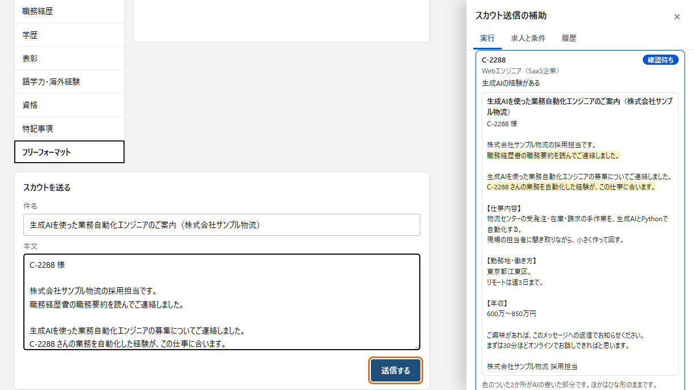

# recruiting-scout-extension

[](https://github.com/Mxhlix/recruiting-scout-extension/actions/workflows/test.yml)

English | [日本語](#日本語)

A Chrome extension that reads candidates' work history documents and drafts who to send recruiting messages to and what to say.
AI (Gemini) decides whether to send and writes part of the message. A recruiter reviews each message one by one and presses send.
It has only been tested on the bundled practice site (13 fictional candidates).



The right side is the extension's control panel. The two highlighted parts are written by the AI. Everything else is the company's fixed template as is.
This screenshot was taken during an automated test, so the AI parts contain a fixed reply used for testing.

## What it does

- Searches candidates with set keywords and opens the results from the top.
- Opens and reads the 10 sections of a work history one by one (basic info, preferences, work experience and so on).
- The AI compares the job with the work history and returns "send / don't send" with a reason. The AI's instructions say not to send if the candidate wrote something like "please hold off on recruiting messages".
- When sending, the AI writes only two parts: the opening and why the candidate fits. The salutation, job description, location, salary and signature use the company's fixed template text as is.
- It stops once the message is in the form and waits until the recruiter presses "send" or "skip".
- The decision, the reason and the message sent are kept in a history, which can be saved as CSV.
- The job details, template, search keywords, limits and AI key can be changed in the panel's 「求人と条件」 (Job and criteria) tab.

## Design notes

- Keep the AI's scope narrow. Most of the message is fixed by the template, and the two AI-written parts are checked by code for length and content. If something that belongs in the template slips in, such as salary, location, 【】 section headings or "！", the reply is rejected and the AI is called again once. If that also fails, it stops there without sending.
- When in doubt, don't send. The AI's instructions say not to send when conditions don't match or the decision is unclear. If a page action or an AI call fails along the way, it also stops without sending.
- A person makes the final check. Every message waits for review one at a time. There is no setting to send without review. If the recruiter edits the message in the page's form before sending, the edited text is what goes into the history.
- Never send to the same person twice. Candidates in the history, or marked "sent" on the site, are skipped without opening their work history.
- Limit the volume. There are daily limits on messages sent and profiles opened (default 30 messages and 150 people). When a limit is reached, it stops for the day.
- Run only on the practice site. The extension runs only on `http://localhost:8974` (set in `manifest.json`). Using this kind of automation on a real service requires following that service's terms of use. If the terms do not allow automation, it cannot be used. This repository has never been run against a real service.
- Keep page selectors in one place. Which buttons and fields to read are collected in `ext/site.js`. To adapt it to a different site, change this file, the target address in `manifest.json`, and the list page path in `background.js` (`SITE_LIST_PATH`).
- Output to the screen is escaped. HTML in a candidate's text or in the AI's reply does not run in the panel.

## What is left out

There is no behavior that imitates a human. For example: randomizing the interval between sends, typing a few characters at a time, or pausing on purpose before a click.
Such behavior has no purpose other than making automation harder for the target service to detect. It would amount to slipping past terms that forbid automation, so it is left out.
For the same reason, there is no setting that keeps sending while skipping the recruiter's review.

## Verification

`npm test` runs the following two kinds of tests. No API key or network access is needed.

- Unit tests (`test/logic.test.js`, 12 tests): building the AI prompt, filling in the template, line breaks at sentence ends, and how AI replies are checked (unreadable replies, rule violations and replies that are not a decision are sent for a retry).
- End-to-end tests (`test/e2e.test.js`, 2 tests): Playwright launches headless Chromium with the extension installed and runs everything from search to sending on the practice site. The AI calls are replaced with a fake that returns fixed replies.
  - Candidates the AI skipped, candidates the recruiter skipped, and candidates already contacted receive nothing. Only those chosen for sending receive a message. The sent message contains both the template text and the two AI parts.
  - If the AI's reply is unreadable twice in a row, it stops without sending to anyone.

Writing the unit tests exposed a bug where an AI reply that is not a decision, such as `null`, made it stop without retrying. It is fixed and covered by the tests.

## Getting started

This is not built to fit every environment or need as is. Adapt the parts you need to your target pages and job.

The tests pass locally on Node.js 24 with the Chromium that Playwright installs.

```
npm install
npx playwright install chromium   # browser used by the end-to-end tests
npm test                          # unit tests and end-to-end tests
npm run serve                     # open the practice site at http://localhost:8974
```

Steps to load the extension into Chrome:

1. Open `chrome://extensions` and turn on 「デベロッパー モード」 (Developer mode) at the top right.
2. Use 「パッケージ化されていない拡張機能を読み込む」 (Load unpacked) and select the `ext/` folder.
3. With `npm run serve` still running, open `http://localhost:8974` and open the panel with the extension's toolbar button.
4. Enter a Gemini API key in the 「求人と条件」 tab, then press 「開始」 (Start) in the 「実行」 (Run) tab.

The practice site's record of sent messages is kept in the browser (localStorage). Clear it to start over.

## Project layout

```
ext/
  manifest.json   extension settings (runs only on localhost:8974)
  background.js   drives the sequence (search → read → AI decision → fill in → review → send → history)
  logic.js        AI prompt, template filling, checks on AI replies
  content.js      reads, fills in and clicks inside the page
  site.js         where things are on the target pages
  panel.*         the control panel on the right
site/             practice candidate search, work histories and message form (13 fictional candidates)
serve.js          serves the practice site
test/             unit tests and end-to-end tests
docs/             screenshots
```

## Not yet verified

- The path that calls the real Gemini is not exercised by the tests in this repository. The tests replace the AI with a fake. Whether the default model name (`gemini-3.6-flash`) is still available is also not verified here.
- How accurate the AI's decisions are (sending to the right people and skipping the wrong ones) has not been measured.
- The manual steps for loading into Google Chrome (steps 1 to 4 in "Getting started") were not walked through by hand when building this repository. The tests load the same `ext/` into Playwright's Chromium.
- It has not been run on a real job site. If the page structure differs, `site.js` will need changes.
- Waiting and retrying when the AI service is busy (429, 503) is not tested.

## License

MIT. See [LICENSE](LICENSE).

---

## 日本語

候補者の職務経歴書を読み、スカウトの送り先と文面の案を作る Chrome 拡張機能です。
送るかどうかと文面の一部を AI（Gemini）が決め、送信は担当者が1通ずつ確かめてから押します。
動作は、同梱の練習用サイト（架空の候補者13人）だけで確かめています。


右側が拡張機能の操作パネルです。色のついた2か所が AI の書いた部分で、ほかは会社が決めたひな形のままです。
この写真は自動テストの途中で撮ったもので、AI の部分にはテスト用の決まった返事が入っています。

### できること

- 決めた言葉で候補者を検索し、結果を上から順に開きます。
- 職務経歴書の10項目（基本情報・希望条件・職務経歴など）を1つずつ開いて読みます。
- AI が、求人と職務経歴書を見比べて「送る / 送らない」と理由を返します。候補者が「スカウトは控えて」などと書いていれば送らないよう、AI への指示で決めています。
- 送る場合、AI が書くのは「書き出し」と「合う所」の2か所だけです。宛名・仕事内容・勤務地・年収・署名は、会社が決めたひな形の文をそのまま使います。
- 文面を送信欄に入れたところで止まり、担当者が「送る」か「見送る」を押すまで待ちます。
- 判定・理由・送った文面を履歴に残し、CSV で保存できます。
- 求人の中身・ひな形・検索する言葉・上限・AI のキーは、パネルの「求人と条件」タブで変えられます。

### 設計で気をつけたこと

- **AI に書かせる範囲を狭くする。** 文面の大部分はひな形で固定し、AI の書いた2か所は長さと中身を機械で確かめます。年収・勤務地・【】の見出し・「！」などひな形にあるべきものが紛れていれば受け取らず、1回だけ呼び直します。それでもだめなら、その先は送らずに止めます。
- **迷ったら送らない。** AI への指示で、条件が合わないときや迷うときは送らないよう決めています。途中で画面の操作や AI の呼び出しに失敗したときも、送らずに止めます。
- **人が最後に確かめる。** 必ず1通ずつ確認待ちになります。確認なしで送る設定はありません。担当者がページの送信欄で文面を直してから送った場合は、直した文面を履歴に残します。
- **同じ人に二度送らない。** 履歴かサイト上の「送信済み」の印がある人は、職務経歴書を開かずに飛ばします。
- **送る量を抑える。** 1日に送る数と開く数に上限があり（既定は30通と150人）、上限に達するとその日は止まります。
- **練習用サイトでしか動かさない。** 拡張機能が動くのは `http://localhost:8974` だけです（`manifest.json` で指定）。本物のサービスでこの種の自動操作を使うときは、そのサービスの利用規約に従う必要があります。規約で自動操作が認められていなければ使えません。このリポジトリでは本物のサービスに対して一度も動かしていません。
- **画面の場所の指定を1か所にまとめる。** どのボタンや欄を読むかは `ext/site.js` に集めています。別の画面に合わせるときは、ここと `manifest.json` の対象アドレス、`background.js` の一覧ページのパス（`SITE_LIST_PATH`）を書き換えます。
- **画面への出力はエスケープする。** 候補者の文や AI の返事にHTMLが入っていても、パネルでは実行されません。

### 入れていない動き

人の操作に見せかける動きは入れていません。たとえば、送信の間隔を毎回ばらつかせる、文字を数文字ずつ打つ、押す前にわざと間を置く、といった動きです。
これらは、相手のサービスに自動操作だと気づかれにくくする以外の目的がありません。自動操作を禁止している規約をすり抜けることになるため、入れていません。
同じ理由で、担当者の確認を飛ばして送り続ける設定も作っていません。

### 検証

`npm test` で次の2種類を動かします。APIキーも通信も要りません。

- 単体テスト（`test/logic.test.js`、12項目）: AI への指示文の組み立て、ひな形の差し込み、句点での改行、AI の返事の確かめ方（読めない返事・決まり違反・判定の形でない返事を呼び直しに回すこと）。
- 通しのテスト（`test/e2e.test.js`、2項目）: Playwright で拡張機能を入れた Chromium を画面なしで起動し、練習用サイトで検索から送信までを動かします。AI の呼び出しは、決まった返事を返す偽物に差し替えています。
  - AI が見送った人、担当者が見送った人、前に送った人には送られず、送ると決めた人にだけ送られること。送った文面に、ひな形の文と AI の2か所の両方が入っていること。
  - AI の返事が2回続けて読めなければ、誰にも送らずに止まること。

単体テストを書く途中で、AI が `null` のような判定の形でない返事を返したときに、呼び直さずに止まる不具合が見つかりました。直したうえで、テストに残しています。

### 動かし方

どの環境や要望にもそのまま合う作りではありません。対象の画面や求人に合わせて、必要なところは書き換えて使ってください。

テストは手元の Node.js 24 と、Playwright が入れる Chromium で通しています。

```
npm install
npx playwright install chromium   # 通しのテストで使うブラウザ
npm test                          # 単体テストと通しのテスト
npm run serve                     # 練習用サイトを http://localhost:8974 で開く
```

拡張機能を Chrome に入れる手順です。

1. `chrome://extensions` を開き、右上の「デベロッパー モード」を入れます。
2. 「パッケージ化されていない拡張機能を読み込む」で `ext/` フォルダを選びます。
3. `npm run serve` を動かしたまま `http://localhost:8974` を開き、ツールバーの拡張機能のボタンでパネルを開きます。
4. 「求人と条件」タブで Gemini の APIキーを入れ、「実行」タブの「開始」を押します。

練習用サイトの送信済みの記録はブラウザの中（localStorage）に残ります。消すとやり直せます。

### フォルダ構成

```
ext/
  manifest.json   拡張機能の設定（動く場所は localhost:8974 だけ）
  background.js   順番を回す部分（検索 → 読む → AI の判定 → 入力 → 確認 → 送信 → 履歴）
  logic.js        AI への指示文・ひな形の差し込み・AI の返事の確かめ方
  content.js      ページの中で読む・入力する・押す部分
  site.js         対象の画面のどこに何があるか
  panel.*         右側の操作パネル
site/             練習用の候補者検索・職務経歴書・送信欄（架空の候補者13人）
serve.js          練習用サイトの配信
test/             単体テストと通しのテスト
docs/             画面写真
```

### まだ確かめていないこと

- 本物の Gemini を呼ぶ経路は、このリポジトリのテストでは通していません。テストでは AI を偽物に差し替えています。既定のモデル名（`gemini-3.6-flash`）が今も使えるかも、ここでは確かめていません。
- AI の判定がどのくらい正しいか（送るべき人を送り、送るべきでない人を見送れるか）は測っていません。
- Google Chrome に手で読み込む手順（「動かし方」の1〜4）は、このリポジトリを作るときに手で通していません。テストは Playwright の Chromium に同じ `ext/` を読み込ませて動かしています。
- 本物の転職サイトでは動かしていません。画面の作りが違えば `site.js` の書き換えが要ります。
- AI 側が混んでいるとき（429・503）に間を空けて呼び直す処理は、テストしていません。

### ライセンス

MIT です。[LICENSE](LICENSE) を見てください。
